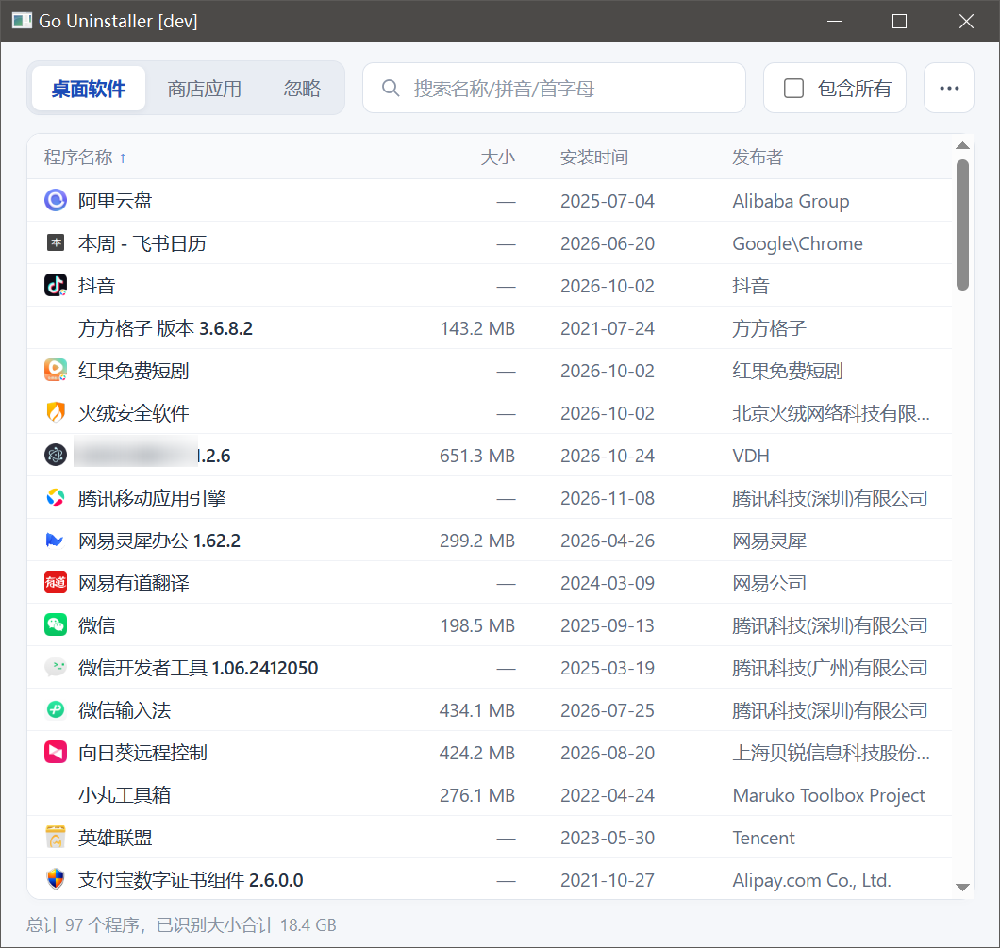
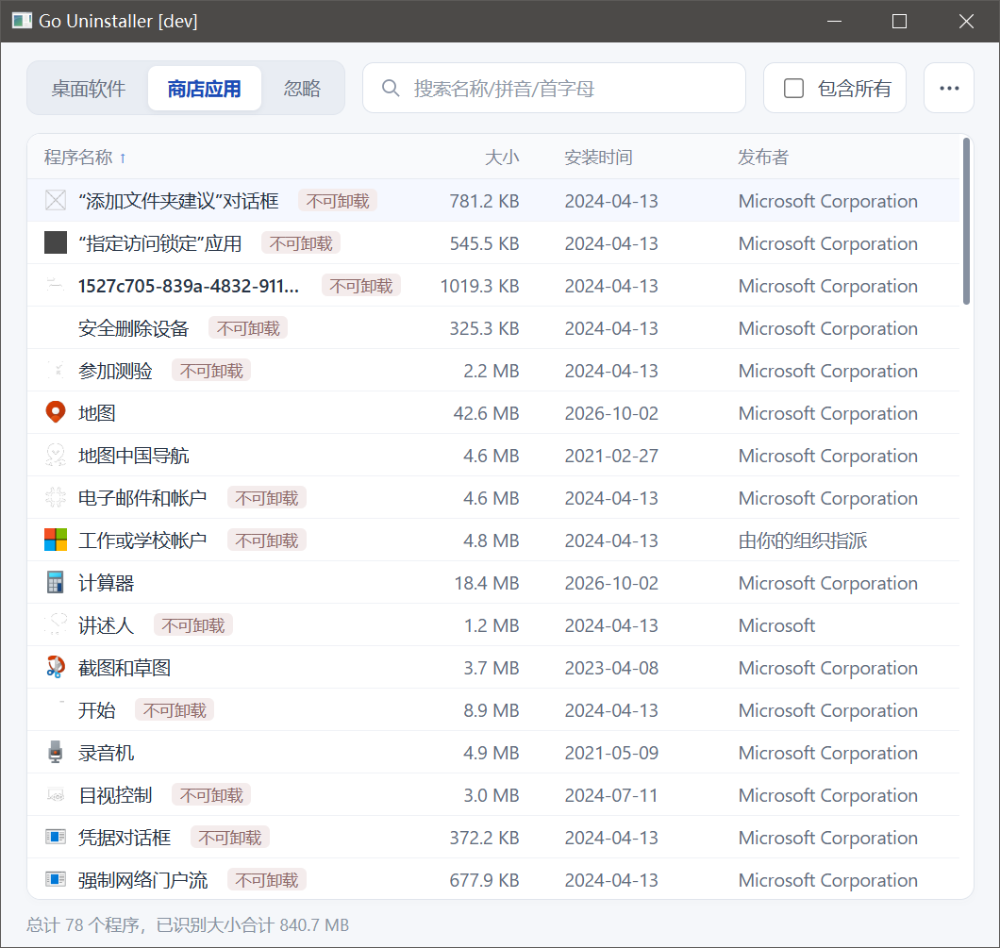
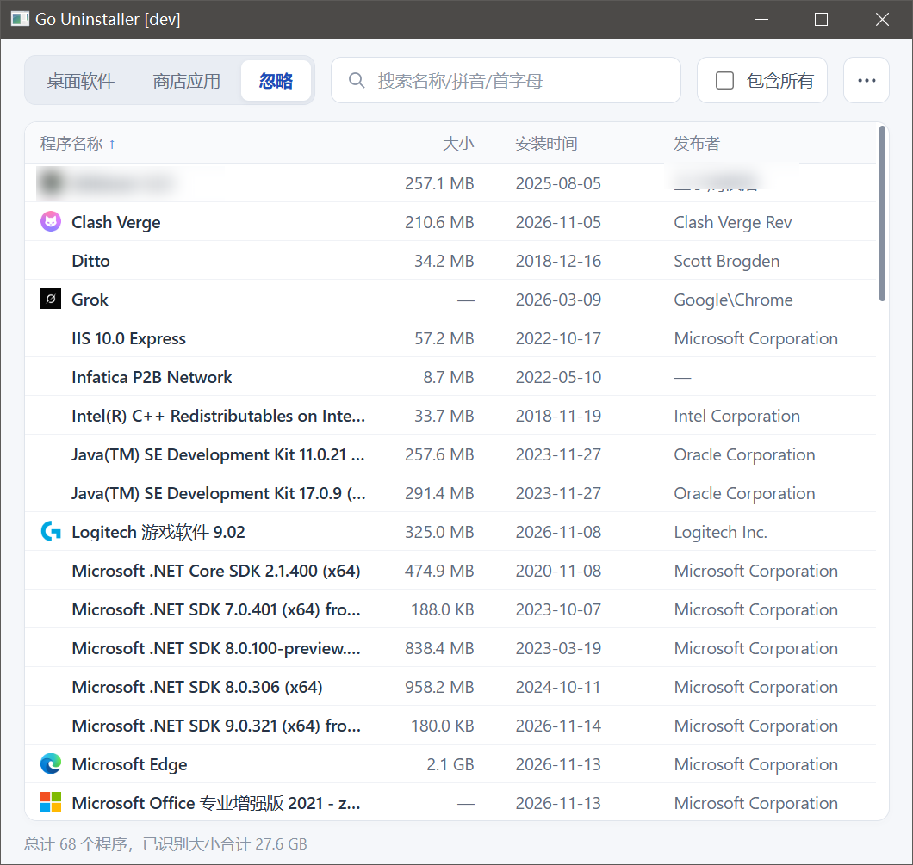
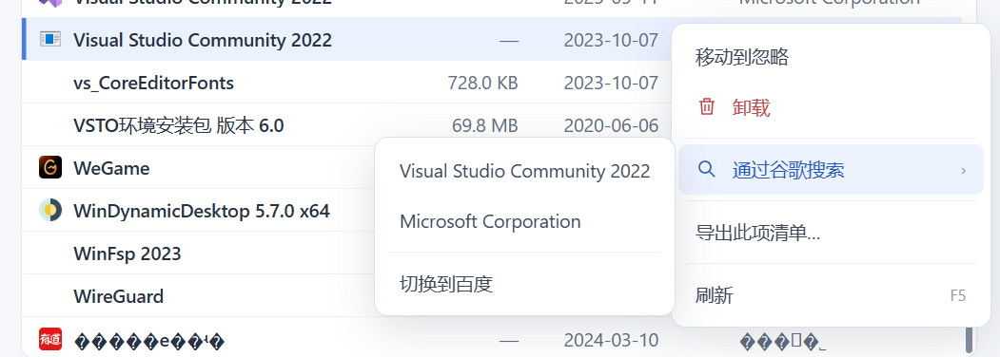
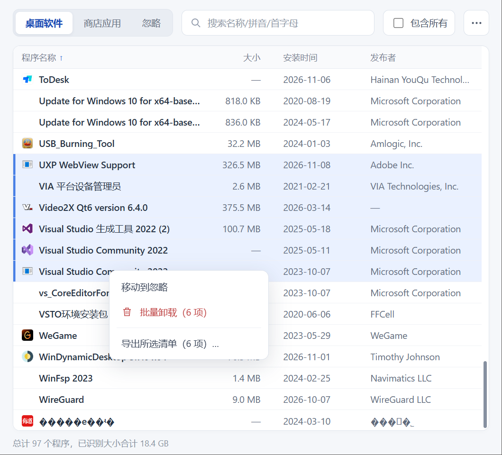
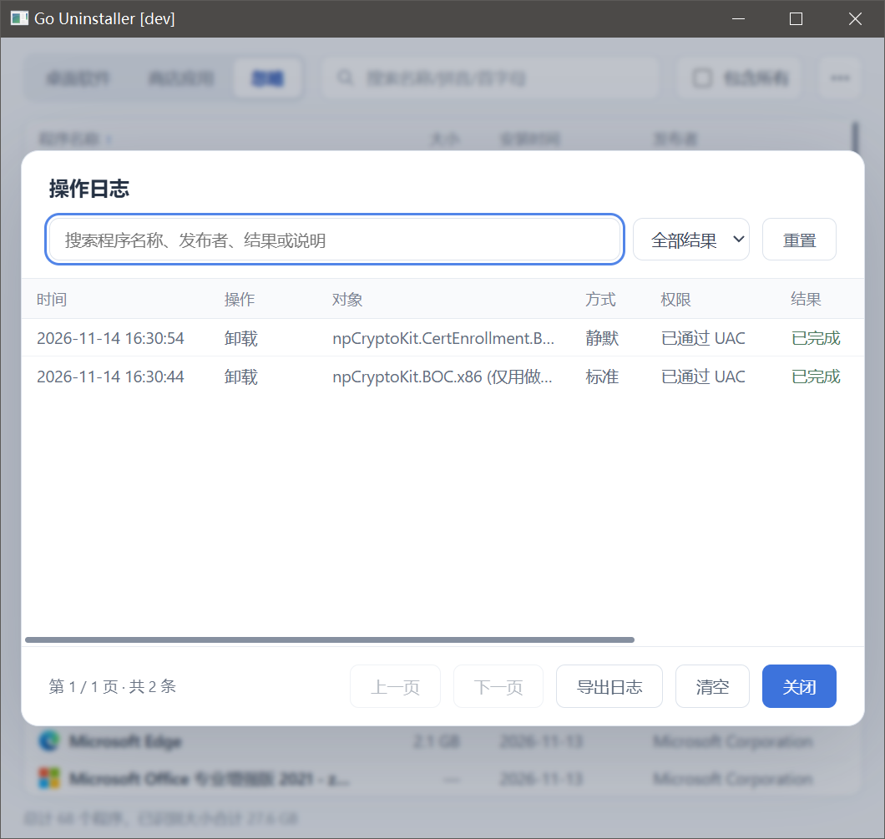

# Go Uninstaller

Windows x64 桌面卸载工具，当前为 0.5 版。免安装，直接运行。界面使用 go-webview2 和内嵌 HTML/CSS/JavaScript，运行前需要系统已安装 [Microsoft Edge WebView2 Runtime](https://developer.microsoft.com/microsoft-edge/webview2/)（Windows 11 和较新的 Windows 10 通常已自带）。没有 .NET、PowerShell、Node、Python、Electron 或 BCU 运行依赖。相比原生界面，WebView2 会占用额外运行内存。

可执行文件未做代码签名，首次运行时 Windows SmartScreen 可能拦截，需要选择仍要运行。

## 下载

发布包：[Releases](https://github.com/HyhBlazing/GoUninstaller/releases) 中的 `GoUninstaller-0.5.0-windows-amd64.zip`，解压后运行 `GoUninstaller.exe`。

也可以自行编译，见文末。

## 界面

桌面软件、商店应用、忽略三个列表。搜索支持中文、拼音和首字母。



商店应用按保护级别标注。标为“不可卸载”的系统组件不能卸载。



右键可以把不关心的程序移动到忽略列表。



右键可以卸载、按谷歌或百度搜索名称和发布者、导出当前项，并刷新列表。



多选后可以批量卸载，或导出已选程序的清单。



每次卸载、清理和导出都会写入本机操作日志，包含是否通过 UAC。



## 使用

### 0.5 版新增

**卸载可靠性**

- 卸载是否成功以“安装记录是否消失”为准，不只看卸载程序的退出码。结果分为已完成、需重启、未完成（卸载程序已退出但记录仍在）、已取消、失败、已阻止六种，每种都有中文说明。
- 许多卸载程序会先启动再把工作交给子进程（NSIS、部分厂商引导程序）。现在会跟踪卸载程序启动后产生的后代进程，等它们全部退出后再判定结果；浏览器、资源管理器等被顺带打开的程序不计入等待。
- 启动失败按原因分类：取消 UAC、卸载程序文件缺失、无权限启动、需要提权（自动改用管理员身份重试一次）。MSI 的常见退出码（1602 用户取消、1603 安装失败、1605 产品不存在、1618 另一安装进行中、3010/1641 需重启等）有对应说明。
- 另一个 Windows Installer 任务正在进行时，MSI 卸载会先等待最多 20 秒，仍被占用则提示稍后再试，而不是直接报错。
- 等待期间可点击“不再等待”：只停止本工具的等待，不会结束卸载程序。单个卸载最长等待 2 小时。
- 商店应用卸载对常见失败（应用正在运行、包被其他应用依赖、系统策略禁止等）给出中文原因。

**标准卸载与静默卸载**

- 默认是标准卸载：运行程序自带的卸载向导，行为与系统“程序和功能”一致。
- 静默卸载是确认框中的可选项，勾选后会记住。只在能识别出可靠的静默方式时才生效，识别顺序为：MSI（`/qn /norestart`）、厂商登记的 `QuietUninstallString`、Inno Setup、NSIS、WiX Burn、Squirrel。
- 识别不出静默方式的程序不会被强行加参数，而是回退到标准卸载并在结果里注明。确认框会事先说明所选程序中有几项支持静默。
- 静默卸载不显示向导，因此也不会出现“是否保留用户数据”之类的询问，按该卸载程序的默认选项执行。

**批量卸载**

- 列表中多选（Ctrl/Shift 点击）后右键选择“批量卸载（N 项）”，或按 Delete 键。确认框列出全部程序。
- 队列按顺序逐个执行，不并行。单项失败或取消不会中断队列。运行中可“不再等待当前项”或“停止队列”（当前项结束后停止，剩余项标记为未执行）。
- 结束后显示每项的结果与原因，可对未完成项以标准模式重试，并对所有已卸载的程序统一扫描残留；残留列表会标明每一项属于哪个程序。
- 不可卸载的系统组件会自动从批量选择中排除；系统相关的商店应用会在确认框中标出。

**导出软件清单**

- 右上角“更多操作”或右键菜单中的“导出”。范围可选已选择的程序、当前列表、全部桌面软件与商店应用；格式可选 CSV 或 JSON。
- CSV 为带 BOM 的 UTF-8，可直接用 Excel 打开；以 `=`、`+`、`-`、`@` 开头的单元格会加前缀，避免被当作公式执行。JSON 字段为 snake_case，包含导出时间与计算机名。
- 字段：名称、版本、发布者、类型、安装日期、大小、安装范围、架构、安装位置、保护级别、卸载命令、标识。

**操作日志**

- “更多操作”中的“操作日志”记录每一次卸载、残留清理和清单导出：时间、对象、方式（标准/静默）、权限情况、结果与说明。
- 权限一栏区分：无需提权、已通过 UAC、管理员身份、UAC 已取消、提权失败，便于排查“为什么没卸掉”。
- 支持按关键字搜索、按结果筛选、重置、分页，可导出为 CSV，可清空（需二次确认）。
- 日志保存在 `%LOCALAPPDATA%\GoUninstaller\history.jsonl`，超过 2 MB 时只保留最近 2000 条。日志只存在本机，不上传。

### 0.4 版

现代紧凑界面，顶部搜索/标签固定一行、底部计数固定高度、列表填满中间区域。支持桌面软件、商店应用、忽略三个标签；右键可将程序“移动到忽略”（未勾选“包含所有”时桌面/商店不显示），在忽略标签或已忽略项上右键显示“还原”。“包含所有”勾选后桌面/商店也会显示已忽略项。列标题右键可配置显示列（程序名称不可隐藏），默认隐藏版本与发布者；设置持久化到 `%LOCALAPPDATA%\GoUninstaller\settings.json`。搜索支持中文、拼音与首字母。F5 刷新；缺失或损坏图标使用 Windows 默认应用图标。右键支持通过谷歌或百度搜索程序名称/发布者，可在子菜单中切换并记住选择。

### 更早版本

0.3 版：F5 刷新当前标签；启动仅加载桌面软件，商店应用首次切换时加载并缓存。列表右键可卸载或刷新。主界面已移除选中详情和额外说明，顶部采用固定高度的紧凑搜索栏。

0.2 版：程序名称前显示图标，列表增加大小、安装时间；桌面软件与商店应用通过独立标签切换。大小优先使用安装程序登记值，缺失时尝试统计安装目录（有时间上限），不含安装目录之外的数据；无法读取时显示“—”。安装日期优先读取 InstallDate（字符串或数值），缺失时与系统“程序和功能”一致，回退到卸载注册表键最后写入时间；仍缺失时再用安装目录创建时间。更新或重装可能改变此日期。商店应用优先显示 Shell 中的本地化程序名。

### 基本流程

运行 `GoUninstaller.exe`。支持桌面软件与当前用户商店应用列表、搜索、点击列标题排序。选中软件后右键选择卸载（或按 Delete 键）；桌面软件运行其注册的卸载程序，商店应用调用 Windows 原生 WinRT PackageManager.RemovePackageAsync。需要权限的机器级卸载会触发 UAC。

卸载程序退出且安装记录消失后，自动弹出“正在扫描残留…”对话框；扫描结束后若有残留则供勾选清理，若无残留也会显示结果并需点击完成确认。默认不勾选任何候选项，需核对路径；名称匹配不证明文件一定无用。

目录清理采用原位置改名备份，不直接递归删除，也不立即释放磁盘空间。可关闭相关程序后将 `原目录.GoUninstaller-backup-时间` 改回原名称恢复。备份记录及注册表导出文件保存在 `%LOCALAPPDATA%\GoUninstaller\Backups`，注册表可通过备份 `.reg` 文件恢复。

## 当前范围与限制

- 读取 HKCU/HKLM 的 32/64 位卸载记录，隐藏系统组件及子更新条目。
- 商店列表过滤框架、资源和 bundle 包。其余商店包按签名与包名分为普通应用、系统相关、不可卸载三类：系统签名 / Windows 发布者 / 壳与登录等组件禁止卸载；商店、安全中心、应用安装程序等标为系统相关并需额外确认；普通应用可正常卸载。只处理当前用户，不移除其他用户或系统预配包。
- 残留只检查精确产品名称对应的安装/应用数据目录、当前用户产品注册表键，以及商店应用的用户数据目录。不会全盘模糊搜索，也不清理共享发布者目录、服务、任务、驱动、浏览器扩展。
- 不支持所有非标准卸载命令。卸载程序退出后安装记录仍在（已取消、失败或需重启后才生效）时，结果记为“未完成”，不会弹出残留清理；确认卸载完成或重启后再执行卸载流程。
- 静默卸载依赖对安装器类型的识别。自研安装器、被加壳或改过的安装器可能识别不出，此时回退到标准卸载。个别安装器虽被识别，仍可能弹出自己的提示窗口，这由卸载程序本身决定。
- 后代进程跟踪基于进程父子关系。卸载程序若通过服务、计划任务等方式间接启动工作进程，无法被跟踪，此时仍以安装记录是否消失作为最终依据。
- 批量卸载按顺序执行，不并行；每个需要权限的机器级程序会各自触发一次 UAC 确认。
- 目录权限不足、重解析点/链接、共享目录会跳过或报告失败。备份与清理操作并非事务；目录内部仍可能有独立软件或个人数据，需人工核对。
- 没有强制删除安装记录、便携版模式（设置与日志仍写入 `%LOCALAPPDATA%`）、主题、收藏、备注。
- 验证范围：单元测试覆盖结果判定、卸载命令解析、静默方案生成、日志与导出；卸载等待、子进程跟踪和中止逻辑用系统自带的 `cmd.exe` 充当卸载程序做了实际进程测试；界面用 `--ui-smoke` 和模拟数据逐个检查了各对话框。作者在自己的电脑上做过少量真实卸载，各类安装器的兼容性还没有系统验证。
- 作为正式产品发布前仍缺少：可执行文件代码签名（未签名会被 SmartScreen 拦截）、安装包与自动更新、授权与激活、崩溃上报。

## 修改与编译

需要 Go 1.20 或更高版本。此版从零实现，不复用 BCU 源码。主要文件：

- `ui.html`：现代界面组件、布局、搜索排序和右键菜单。
- `webui_windows.go`：WebView2 框架接入、Go 后端操作接口、图标与网络搜索。
- `settings_windows.go`：界面设置与系统应用分类持久化。
- `cache_windows.go`：程序列表磁盘缓存，刷新时只补拉新增或变更项。
- `pinyin_windows.go`：名称/发布者拼音与首字母索引。
- `main_windows.go`：程序入口与图标辅助模型。
- `inventory_windows.go`：桌面软件注册表读取。
- `store_windows.go`：原生 WinRT 商店列表和卸载。
- `store_protect_windows.go`：商店应用保护分级。
- `uninstall_windows.go`：卸载执行、UAC 提权、等待与结果判定。
- `silent_windows.go`：安装器类型识别与静默卸载方案。
- `process_windows.go`：卸载程序后代进程跟踪。
- `history_windows.go`：操作日志存储、查询与导出。
- `export_windows.go`：软件清单导出（CSV/JSON）与保存对话框。
- `scan_windows.go`：残留匹配、路径保护与备份清理。

```powershell
go test ./...
go build -trimpath -ldflags "-H windowsgui -s -w" -o GoUninstaller.exe .
```

开发界面时可用 `--dev`：从磁盘读取 `ui.html`，保存后自动热更新，无需为改样式/布局/前端脚本反复编译。窗口标题会显示 `[dev]`。在项目目录运行：

```powershell
go run . --dev
# 或先编译再开发前端
go build -o GoUninstaller.exe .
.\GoUninstaller.exe --dev
```

找不到 `ui.html` 时可设置环境变量 `GOUNINSTALLER_UI` 指向该文件。改 Go 后端仍需重新编译并重启。正式发布不要带 `--dev`，继续使用内嵌界面。

已有 `rsrc_windows_amd64.syso` 内嵌应用清单。若更改 `app.manifest`，重新生成：

```powershell
go run github.com/akavel/rsrc@v0.10.2 -manifest app.manifest -o rsrc_windows_amd64.syso
```

只读导出列表：`GoUninstaller.exe --inventory`。不接受命令行卸载/清理参数。

## 第三方依赖

界面框架 go-webview2/go-winloader（MIT），图标转换使用 lxn/walk、lxn/win（BSD）；Windows 接口使用 golang.org/x/sys（BSD）；walk 间接依赖 govaluate（MIT）。对应许可在 `THIRD-PARTY` 目录。运行时需要 Windows 系统组件及 WebView2 Runtime。
